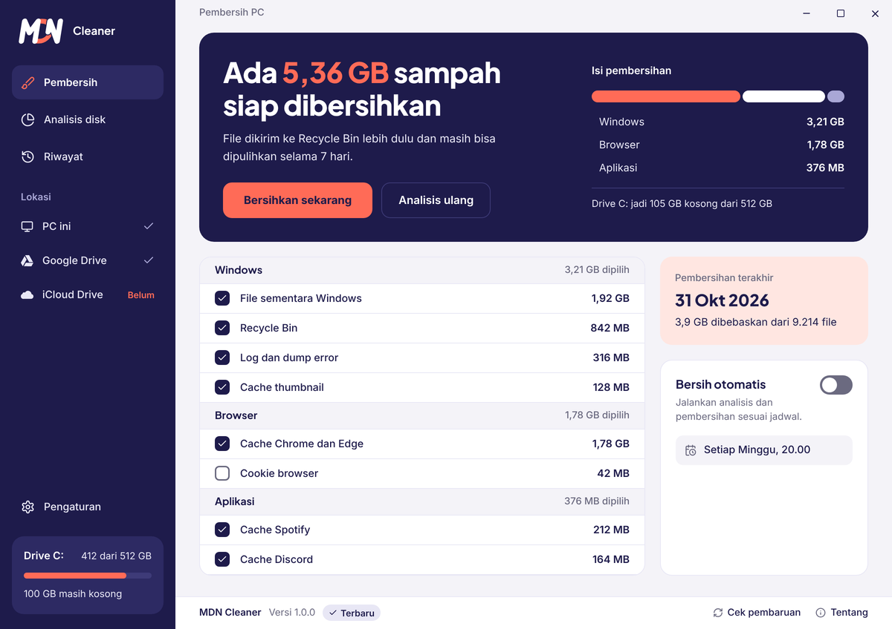
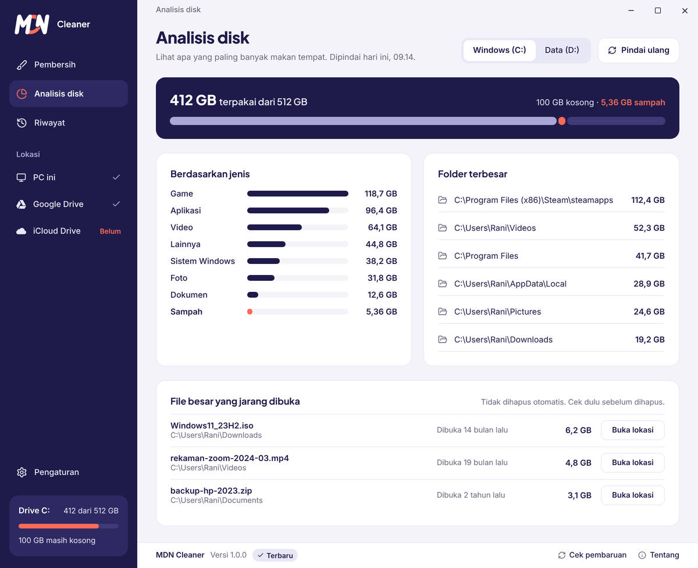
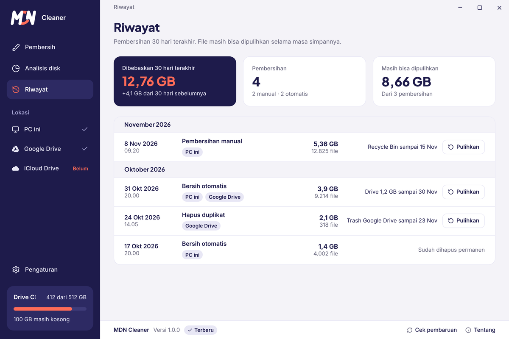
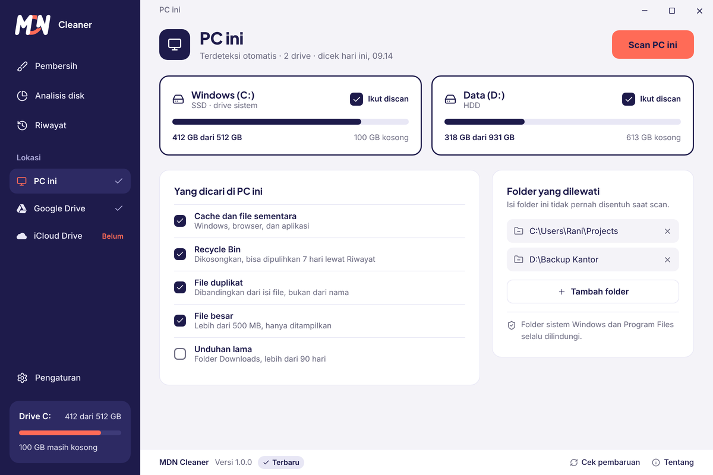
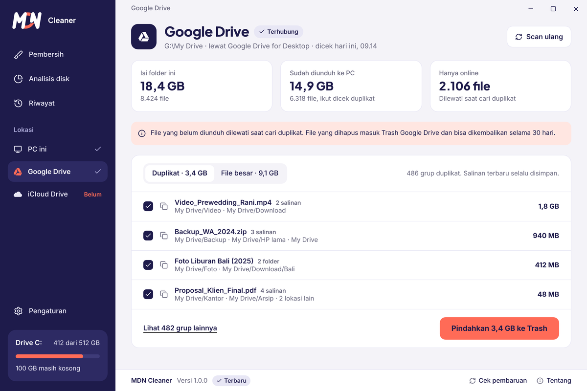
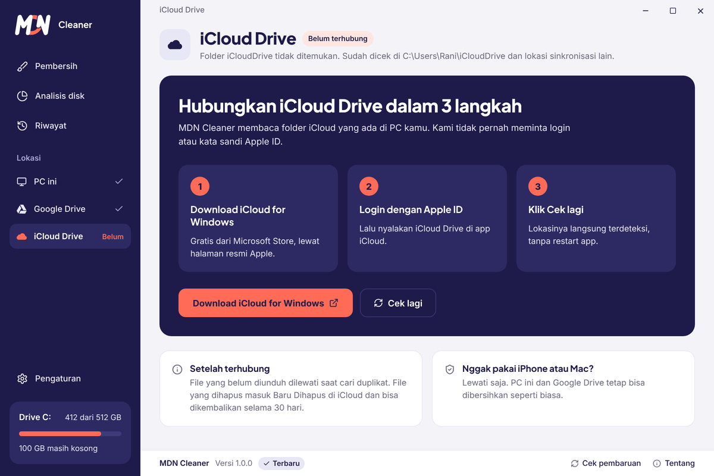
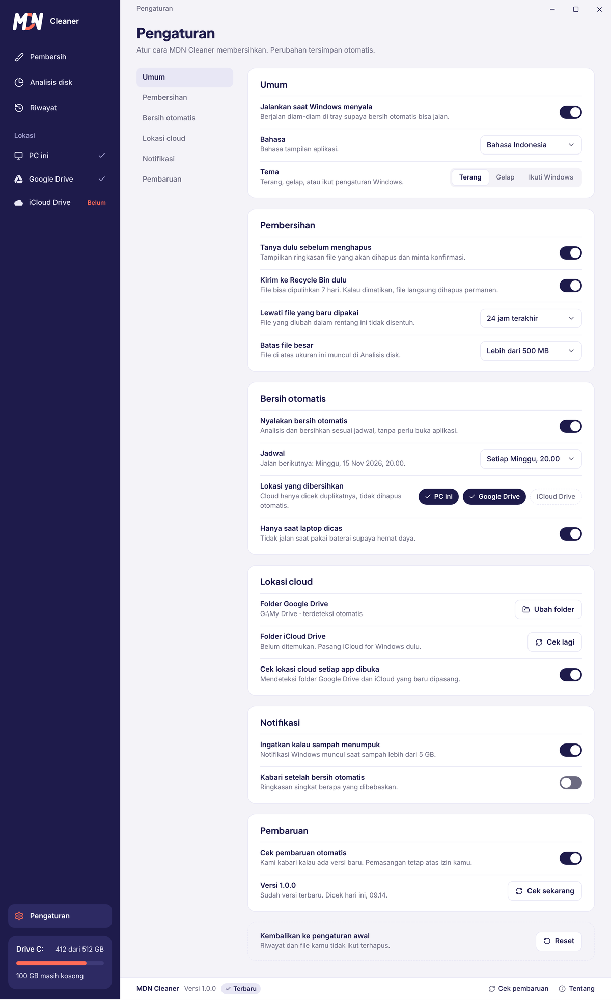
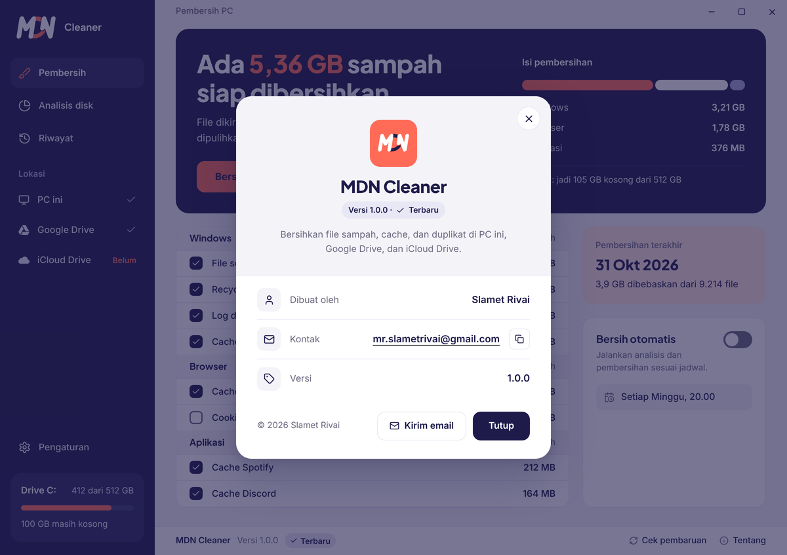

# MDN Cleaner

Aplikasi pembersih untuk Windows yang aman dipakai: sampah dikirim ke Recycle Bin lebih dulu, jadi masih bisa dipulihkan lewat **Riwayat** selama 7 hari. Dibuat dengan **Rust + Tauri v2**, tampilan mengikuti design "MDN Pembersih Window V2".



## Fitur

### Pembersih
Memindai PC dan menampilkan berapa GB sampah yang siap dibersihkan, dikelompokkan per kategori. Centang apa yang mau dibersihkan, lalu klik **Bersihkan sekarang**.

| Kelompok | Yang dibersihkan |
|---|---|
| Windows | File sementara (`%TEMP%`, `C:\Windows\Temp`), Recycle Bin, log dan dump error, cache thumbnail |
| Browser | Cache Chrome dan Edge, cookie browser (tidak dicentang secara default) |
| Aplikasi | Cache Spotify, cache Discord (hanya muncul kalau aplikasinya terpasang) |
| File pribadi | File duplikat, unduhan lama |

### Analisis disk
Lihat apa yang paling banyak makan tempat: pemakaian per jenis (game, aplikasi, video, foto, dokumen, sistem), 6 folder terbesar, dan file besar yang jarang dibuka. Klik folder atau **Buka lokasi** untuk membukanya di File Explorer. Bisa pindah antar drive.



### Riwayat
Catatan pembersihan 30 hari terakhir: berapa GB yang dibebaskan, jumlah pembersihan (manual dan otomatis), dan tombol **Pulihkan** untuk mengembalikan file ke tempat asalnya selama masa simpannya.



### PC ini
Daftar drive yang terdeteksi (SSD atau HDD, drive sistem), pilihan **Ikut discan** per drive, apa saja yang dicari, dan **Folder yang dilewati** yang tidak pernah disentuh saat scan.



### Google Drive dan iCloud Drive
Membaca folder hasil sinkronisasi di PC. **Tidak pernah meminta login atau kata sandi.** Cari file duplikat dan file besar, lalu pindahkan ke Trash Google Drive atau Baru Dihapus iCloud (bisa dikembalikan 30 hari). File yang belum diunduh (hanya online) dilewati. Kalau belum terhubung, halaman ini menampilkan 3 langkah untuk memasangnya.




### Bersih otomatis
Nyalakan di halaman Pembersih atau Pengaturan. MDN Cleaner mendaftarkan tugas di **Windows Task Scheduler** (pukul 20.00, harian, mingguan, atau bulanan) yang berjalan tanpa membuka aplikasi.

- Hanya membersihkan PC. Cloud cuma dicek duplikatnya dan tidak dihapus otomatis.
- File duplikat tidak pernah dihapus tanpa kamu hadir.
- Opsional hanya berjalan saat laptop dicas.

### Pengaturan
Jalankan saat Windows menyala (diam di tray), tema terang/gelap/ikuti Windows, konfirmasi sebelum menghapus, kirim ke Recycle Bin atau hapus permanen, rentang file yang baru dipakai (dilewati), batas file besar, jadwal, notifikasi sampah menumpuk, dan reset ke pengaturan awal. Perubahan tersimpan otomatis.



### Pembaruan otomatis
MDN Cleaner mengecek rilis baru di GitHub saat dibuka dan setiap 6 jam (bisa dimatikan di Pengaturan). Kalau ada versi baru, muncul pemberitahuan di bagian atas dan di footer. Pembaruan diunduh di latar dengan progres yang terlihat, lalu bisa dipasang sekarang (aplikasi ditutup sebentar dan terbuka lagi) atau otomatis saat aplikasi ditutup. Setiap file pembaruan ditandatangani; file yang tanda tangannya tidak cocok ditolak.

### Tentang
Klik **Tentang** di pojok kanan bawah untuk melihat versi aplikasi dan info pembuatnya.



## Cara memakai

1. Buka **Pembersih**. Aplikasi langsung menganalisis dan menampilkan total sampah.
2. Centang atau hapus centang kategori. Pilihan kamu diingat.
3. Klik **Bersihkan sekarang** dan konfirmasi.
4. Salah pakai? Buka **Riwayat** dan klik **Pulihkan** (dalam 7 hari).

Pindai ulang kapan saja dengan **Analisis ulang**.

## Keamanan

- Sampah dikirim ke **Recycle Bin**, bukan dihapus permanen (kecuali kamu matikan di Pengaturan). Setelah 7 hari MDN Cleaner menghapusnya.
- File sementara yang baru dipakai (default 24 jam terakhir) tidak disentuh.
- File duplikat dibandingkan dari **isi file** (ukuran, lalu BLAKE3), bukan dari nama. **Salinan terbaru selalu disimpan.**
- File pribadi tidak pernah ditawarkan untuk dihapus kalau ada di folder Windows, Program Files, ProgramData, AppData, folder game (Steam, Epic, dll), `node_modules`, atau `.git`.
- Folder yang kamu tandai **dilewati** tidak pernah dibuka.
- Beberapa file (misalnya `C:\Windows\Temp`) butuh izin admin. Kalau aplikasi tidak dijalankan sebagai admin, file itu dilewati dan jumlahnya ditampilkan.

## Data dan privasi

Pengaturan dan riwayat disimpan lokal di `%APPDATA%\com.mdn.cleaner`.

Aplikasi mengirim **statistik pemakaian anonim** lewat Firebase Analytics: halaman yang dibuka, dan berapa MB yang dibebaskan saat pembersihan. Nama file dan lokasi folder tidak pernah dikirim. Satu instalasi dihitung sebagai satu pengguna dengan ID acak.

## Menjalankan dari source

Kebutuhan: Windows 10/11, [Rust](https://rustup.rs) (toolchain MSVC), Visual Studio Build Tools, Node.js 20+, dan WebView2 (sudah ada di Windows 11).

```bash
git clone https://github.com/slametrivai/mdncleaner.git
cd mdncleaner
cp .env.example .env     # isi dengan config Firebase milikmu (boleh dikosongkan, analytics mati)
npm install
npm run dev              # jalankan aplikasi
npm run build            # buat installer di src-tauri/target/release/bundle/nsis
```

## Merilis versi baru

Rilis dibuat otomatis oleh GitHub Actions ([release.yml](.github/workflows/release.yml)) setiap kali tag `v*` di-push. Workflow membuat installer bertanda tangan dan `latest.json` yang dibaca updater di aplikasi.

Sekali saja, tambahkan secrets di **Settings → Secrets and variables → Actions**:

| Secret | Isi |
|---|---|
| `TAURI_SIGNING_PRIVATE_KEY` | Isi file `~/.tauri/mdncleaner.key` (jangan pernah di-commit) |
| `TAURI_SIGNING_PRIVATE_KEY_PASSWORD` | Kosongkan kalau kunci dibuat tanpa password |
| `FIREBASE_*` | Nilai yang sama dengan `.env` (opsional, untuk analytics) |

Setiap rilis:

```bash
npm run set-version 1.1.0        # ubah versi di package.json, Cargo.toml, tauri.conf.json
# tulis perubahan di release-notes.md (muncul di dialog pembaruan)
git commit -am "Release v1.1.0"
git tag v1.1.0
git push --follow-tags
```

## Struktur project

```
src/                 Frontend (HTML, CSS, JavaScript)
  js/views/          Satu file per halaman
src-tauri/src/       Backend Rust
  cleaner.rs         Scan dan bersihkan kategori sampah
  disk.rs            Analisis disk dan info drive
  dupes.rs           Pencari file duplikat
  cloud.rs           Google Drive dan iCloud Drive
  history.rs         Riwayat dan pemulihan
  schedule.rs        Bersih otomatis (Task Scheduler)
  updater.rs         Pembaruan otomatis dari GitHub
  settings.rs        Pengaturan, startup, notifikasi
analytics/           Bundel Firebase Analytics
```

## Belum tersedia

- Bahasa tampilan baru Bahasa Indonesia.
- Hanya Windows.

## Lisensi

Lihat berkas [LICENSE](LICENSE).
